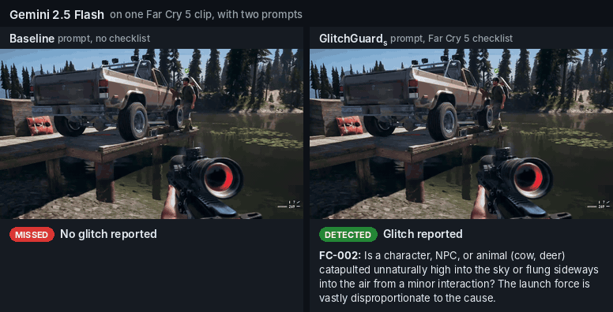

# GlitchGuard Replication Package

GlitchGuard detects and describes bugs in gameplay videos by adding checklists of visual properties of correct gameplay to the prompt of a vision-language model (VLM). This package contains the dataset annotations, the property catalog, every prompt, the per-clip outputs of the seven VLMs in the three evaluated conditions, the matcher validation labels, the RQ3 labels, and the code to recompute the paper's results and to rerun the experiments.



*Far Cry 5 clip `edwq7m`. Left: with the baseline prompt, Gemini 2.5 Flash reports no glitch. Right: with GlitchGuard_s, it detects the launched character and cites property FC-002 (shown with its check question from `properties/far_cry_5.json`). The outcomes are from `results/gemini-2.5-flash.csv`.*

| Condition (paper) | Prompt | Column prefix in `results/` |
|---|---|---|
| Baseline | no checklist | `baseline_` |
| GlitchGuard_g | the 32 generic properties | `generic_` |
| GlitchGuard_s | the game-specific checklist of the clip's title | `specific_` |

## Reproduce the paper's numbers (no GPU, no API keys)

```bash
python3 scripts/reproduce_paper.py               # prints the tables and numbers
python3 scripts/reproduce_paper.py --out tables  # also writes the tables as CSV files to tables/
```

Python 3.8 or later, standard library only. The script reads `results/`, `properties/`, `matcher_validation/`, `rq3/` and `annotations/`:

| Printed output | In the paper |
|---|---|
| Properties per title and per category, buggy clips per title | Table II |
| TP, FN, FP, TN, recall, precision, F1 and FPR for 7 models x 3 conditions, with deltas | Table IV |
| McNemar's exact test and sign test across models, baseline vs GlitchGuard_s | Section V-A |
| Outcome shifts, property-ID citations in improved clips, false-negative sources | Table V |
| Per-game recall | Table VI |
| Properties cited by four or more models in improved clips | Table VII |
| Per-category effectiveness of the generic properties | Table VIII |
| Matcher validation (Cohen's kappa, Cochran sample size) | Section IV-B |
| Clips detected by any model, cross-model recovery, coverage, taxonomy counts | Section V-C |
| G-Pro regressions on RDR2 and GTA V, reasoning examples, CP-001 clips, cost per clip, other numbers quoted in the text | Section VI, Table IX, Fig. 3 |

Table III (property types recurring across engines) groups the game-specific properties in `properties/` by type by hand; the script does not compute it.

## Contents

```
dataset/Games_json.zip    annotations of the 270 clips (videos are downloaded with a script, see Dataset)
properties/               property catalog: 32 generic and 120 game-specific properties (one file per title)
prompts/                  prompt templates, matcher prompt, property-generation prompts
results/                  per-clip outputs of the seven VLMs in the three conditions
matcher_validation/       two authors' labels for 350 matcher decisions
rq3/                      labels of the clips no model detects, coverage of the detected clips
annotations/              manual reasons for the G-Pro regressions discussed in Section VI-A
scripts/                  code: analysis, model runners, semantic matcher, property mining, clip download
environment.yml           conda environment for rerunning the models
figures/                  frames of Fig. 1 and Fig. 3 before and after upscaling
assets/demo.gif           the demo shown at the top of this README
```

## Dataset

270 clips from ten open-world games (135 buggy, 135 clean; the same number of buggy and clean clips per title). The buggy clips of eight titles come from the GamePhysics dataset; the buggy clips of Watch Dogs 2 and Fallout 76 are Reddit-hosted community videos; the clean clips are segments of no-commentary gameplay videos on YouTube.

```bash
cd dataset && unzip Games_json.zip      # creates dataset/Games_json/<title>/<clip>/{gt.json, metadata.json}
```

| `gt.json` field | Content |
|---|---|
| `File` | clip identifier |
| `Game` | game name (also inserted into the prompt) |
| `Descr1`, `Descr2` | human-written descriptions of the bug (empty for clean clips) |
| `Bug Type` | bug category, or `No bug` for clean clips |
| `Source` | URL of the video |
| `Segment` | start and end time in seconds (YouTube clips) |

A clip is identified by its folder, `Games_json/<title>/<clip>/`; the `File` value alone is not unique across the dataset.

The videos are not redistributed. To download them into the clip folders as `video.mp4`:

```bash
pip install yt-dlp requests
python scripts/download_clips.py --root dataset/Games_json --cookies-from-browser chrome
```

For the YouTube (clean) clips, only the clip's `Segment` is downloaded, which needs ffmpeg on the PATH (`environment.yml` includes it). YouTube usually requires browser cookies (`--cookies-from-browser chrome|firefox|safari|edge`). Some Reddit-hosted videos may no longer be available.

## Visual properties

| File | Content |
|---|---|
| `properties/generic.json` | the 32 generic properties (Table II a) |
| `properties/<title>.json` | the game-specific properties of one title, 120 across the ten files (Table II b) |

Each property has an `id`, a `category`, a `name` and a `check` question. In the game-specific files, `in_checklist` marks the properties in the title's GlitchGuard_s checklist; the GlitchGuard_g checklist is the whole generic file. `scripts/shared_prompts.py` builds the prompts from these files and renders each checklist entry as `<id> (<name>): <check>`, in file order; the other fields do not enter the prompt.

Property IDs: MR is the ID prefix the experiments used, so the generic properties are numbered `MR-001` to `MR-032` in the files, the prompts and the model outputs; the paper refers to them as `GP-001` to `GP-032` (same numbers). Game-specific IDs (`CP-`, `FO-`, `F76-`, `FC-`, `GTA-`, `JC-`, `RDR-`, `SK-`, `W3-`, `WD2-`) are the same as in the paper.

## Prompts

| File | Content |
|---|---|
| `prompts/baseline_prompt.txt` | baseline prompt; `{game}` is the `Game` field of the clip's `metadata.json` |
| `prompts/property_prompt.txt` | prompt of GlitchGuard_g and GlitchGuard_s; `{checklist}` is the rendered checklist |
| `prompts/matcher_prompt.txt` | system prompt and user message of the semantic matcher |
| `prompts/figure_upscaling_prompt.txt` | prompt used with Gemini to upscale the frames of Fig. 1 and Fig. 3 (see Figures) |
| `prompts/property_generation_prompt.txt` | prompts used with Gemini 2.5 Pro to generate candidate properties (property mining, Step 2) |

## Results

One CSV per model in `results/`, one row per clip (270 rows), all three conditions side by side. Every model ran at temperature 0.

| Paper | Model | File | Access | Input |
|---|---|---|---|---|
| G3-Pro | Gemini 3.1 Pro (`google/gemini-3.1-pro-preview`) | `results/gemini-3.1-pro.csv` | OpenRouter | video |
| G-Pro | Gemini 2.5 Pro (`gemini-2.5-pro`) | `results/gemini-2.5-pro.csv` | Google Gemini API | video |
| G-Flash | Gemini 2.5 Flash (`gemini-2.5-flash`) | `results/gemini-2.5-flash.csv` | Google Gemini API | video |
| I-78B | InternVL3-78B (`OpenGVLab/InternVL3-78B`) | `results/internvl3-78b.csv` | vLLM, 4x NVIDIA H200 | up to 25 frames |
| I-8B | InternVL3-8B (`OpenGVLab/InternVL3-8B`) | `results/internvl3-8b.csv` | vLLM, 1x NVIDIA H200 | up to 25 frames |
| Q-32B | Qwen2.5-VL-32B (`Qwen/Qwen2.5-VL-32B-Instruct`) | `results/qwen2.5-vl-32b.csv` | vLLM, 4x NVIDIA A100 80GB | up to 25 frames |
| Q-7B | Qwen2.5-VL-7B (`Qwen/Qwen2.5-VL-7B-Instruct`) | `results/qwen2.5-vl-7b.csv` | vLLM, 1x NVIDIA A100 | up to 25 frames |

Open-weight models receive frames sampled at 2 fps, resized so the longer side is at most 1280 px, and uniformly subsampled to the frame cap of 25; for InternVL3, frames wider than 16:9 are first letterboxed to 16:9. Frame selection is deterministic, so for a given clip all three conditions receive the same frames.

For G3-Pro, `check_api_openrouter.py` re-encodes the 123 clips over 14 MB to H.264 at CRF 30 or higher to fit OpenRouter's request limit, using the same file in all three conditions.


| Column | Content |
|---|---|
| `file_id`, `game`, `video_path` | clip identifier, game name used in the prompt, clip path inside the dataset |
| `gt_is_glitch`, `has_gt` | `True` for buggy clips; ground truth available |
| `gt_descr1`, `gt_descr2` | ground-truth bug descriptions |
| `<cond>_raw` | the model's full answer |
| `<cond>_glitch`, `<cond>_desc`, `<cond>_valid_json` | parsed verdict, parsed bug description, answer was valid JSON |
| `<cond>_correct_match` | buggy clip: a bug was reported and the matcher accepted its description; clean clip: no bug was reported |
| `<cond>_time_s` | latency |
| `<cond>_prompt_tokens`, `<cond>_completion_tokens` | logged token counts, used for the cost per clip (Gemini files only) |

## Evaluation

Each answer gets one description-aware outcome:

| Outcome | Clip | Answer |
|---|---|---|
| TP | buggy | bug reported, description accepted by the matcher |
| FN (FN_wrong) | buggy | bug reported, description not accepted |
| FN | buggy | no bug reported |
| FP | clean | bug reported |
| TN | clean | no bug reported |

Recall = TP / (TP + FN); Precision = TP / (TP + FP + FN_wrong); F1 is their harmonic mean; FPR = FP / (FP + TN).

**Semantic matcher.** Claude Sonnet 4 at temperature 0 (`scripts/server_semantic_matcher_claude.py`, prompt in `prompts/matcher_prompt.txt`) decides whether a reported description refers to the same bug as either ground-truth description. Only buggy clips with a reported bug are sent to it.

**Matcher validation.** `matcher_validation/matcher_sample-author1.csv` and `-author2.csv` hold two authors' independent labels for a stratified random sample of 350 matcher decisions drawn from all seven models and three conditions. Columns: `file_id`, `game`, `model`, `condition`, `vlm_description`, `gt_description_1`, `gt_description_2`, `matcher_label`, `human_label_author` (`MATCH` or `NO_MATCH`). `scripts/reproduce_paper.py` computes the agreement.

## RQ3 material

| File | Content |
|---|---|
| `rq3/taxonomy_labels.csv` | label of each of the 37 buggy clips that no model detects under GlitchGuard_s (see `rq3/README.md` for the codebook) |
| `rq3/detected_clips_coverage.csv` | for each of the 98 buggy clips that at least one model detects under GlitchGuard_s: the detecting models, the property IDs they cite, the checklist property that describes the bug, and whether a detecting model cites it |

## Re-running the models

Rerunning needs the videos (see Dataset), API keys for the Gemini models and the matcher, and GPUs for the open-weight models. API models are not fully deterministic even at temperature 0, so reruns can differ slightly from the released outputs.

**1. Environment.**

```bash
conda env create -f environment.yml && conda activate glitchguard
```

**2. Semantic matcher** (port 8002, used by every runner):

```bash
cd scripts
export OPENROUTER_API_KEY='your-key'          # or: export MATCHER_BACKEND=anthropic ANTHROPIC_API_KEY='your-key'
uvicorn server_semantic_matcher_claude:app --host 127.0.0.1 --port 8002
```

**3. Models.** Each runner writes `runs/<model>.csv` in the format of `results/`, with token counts, and prints the metrics; `--conditions`, `--titles` (dataset folder names) and `--max-examples` select a subset, and rerunning the same command resumes.

```bash
cd scripts
export GEMINI_API_KEY='your-key'
python check_api_gemini.py --model gemini-2.5-pro
python check_api_gemini.py --model gemini-2.5-flash

export OPENROUTER_API_KEY='your-key'
python check_api_openrouter.py --model google/gemini-3.1-pro-preview
```

Open-weight models are served with vLLM 0.15.1 through its OpenAI-compatible API. Install it on the GPU machine in its own environment (`pip install vllm==0.15.1`); it is not in `environment.yml` because it needs a newer protobuf than the Gemini packages:

```bash
python -m vllm.entrypoints.openai.api_server --model OpenGVLab/InternVL3-78B --tensor-parallel-size 4 \
    --trust-remote-code --dtype bfloat16 --max-model-len 65536 --gpu-memory-utilization 0.90 \
    --limit-mm-per-prompt '{"image": 25}' --port 8000
# Serve each model in turn with these flags, changing only --model and --tensor-parallel-size:
# 4 for InternVL3-78B and Qwen2.5-VL-32B, 1 for InternVL3-8B and Qwen2.5-VL-7B.

export CLUSTER_VLM_SERVER=http://127.0.0.1:8000/v1
python check_api_cluster.py --model OpenGVLab/InternVL3-78B --max-frames 25 --letterbox-ultrawide
python check_api_cluster.py --model OpenGVLab/InternVL3-8B --max-frames 25 --letterbox-ultrawide

python check_api_cluster.py --model Qwen/Qwen2.5-VL-32B-Instruct --max-frames 25
python check_api_cluster.py --model Qwen/Qwen2.5-VL-7B-Instruct --max-frames 25
```

Each `check_api_cluster.py` command covers all three conditions and all ten titles. `--letterbox-ultrawide` pads frames wider than 16:9 to 16:9 (black bars, all original pixels kept); it was used for InternVL3 only and affects only the two 21:9 clips. InternVL3 splits each frame into tiles by aspect ratio, so without the padding 25 ultrawide frames exceed the 65,536-token context the server is started with.

**4. Re-scoring** a results file with the running matcher:

```bash
python rescore_results.py --csv ../results/gemini-2.5-flash.csv --out rescored.csv
```

## Property mining

| Step | Command or procedure |
|---|---|
| 1. Collect community bug reports (Steam Community Discussions, GameFAQs) | `python scripts/mine_community_bugs.py --output-dir mined_reports` |
| 2. Generate candidate properties with Gemini 2.5 Pro (temperature 0.2, prompts in `prompts/property_generation_prompt.txt`) | `export GOOGLE_API_KEY='your-key'` then `python scripts/generate_properties.py --input-dir mined_reports --output-dir candidates` (candidates for every title, then the generic candidates) |
| 3. Manual revision | two authors independently reviewed every candidate (visible in the video alone; broad enough to justify inclusion; distinguishes bugs from intended mechanics), resolved disagreements by negotiated agreement, and merged redundant candidates into the catalog in `properties/` |

Clean clips were collected with `python scripts/mine_clean_clips.py --root <dataset>` (YouTube search for no-commentary gameplay with negative keywords such as `-glitch -bug -fail`), and two authors reviewed every clip.

## Figures

The frames in Fig. 1 and Fig. 3 were upscaled and brightened with Gemini for readability, using the prompt in `prompts/figure_upscaling_prompt.txt`.

| Folder | Content |
|---|---|
| `figures/fig1/original/`, `figures/fig3/original/` | the frames before upscaling, taken from the clips |
| `figures/fig1/paper/`, `figures/fig3/paper/` | the frames as they appear in the paper |

File names give the panel: for Fig. 1 the row (collision or gravity) and the title, for Fig. 3 the subfigure letter, its label and the clip.

## License

Code and annotations: MIT (see `LICENSE`). The videos belong to their owners and are not included; game titles are trademarks of their respective owners.
